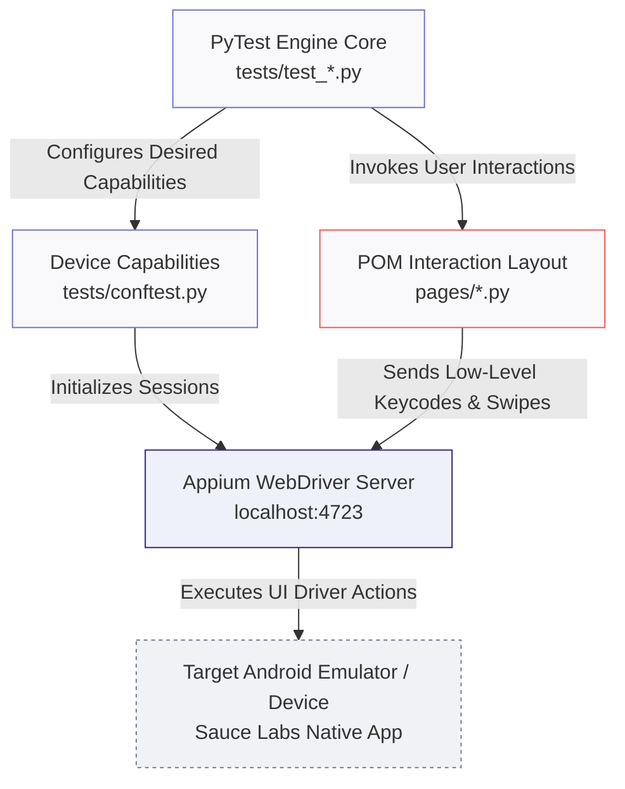

# 📱 Appium Native Regression Test Suite

[](https://github.com)
[](https://appium.io)
[](https://pytest.org)

---

## 🎯 About The Project
This repository hosts a standalone, enterprise-grade mobile test automation architecture engineered from scratch using **Python**, **Appium**, and **PyTest**. Built upon strict **Page Object Model (POM)** patterns, the suite specializes in executing deep regression cycles across native mobile app environments—validated directly against the target containerized **Sauce Labs Mobile Application** UI framework. 

The design pattern addresses standard mobile automation synchronization limits by employing custom explicit wait conditions, hardware system hook overrides, and calculated coordinate fluid viewport manipulation workflows engineered to operate across varied device densities in continuous integration pipelines.

### 🛠️ Key Technical Implementations
* **Dynamic Viewport Swipe Navigation:** Engineered directional coordinate viewport swipe patterns to reliably locate, scroll to, and focus on UI components positioned below the physical screen device fold.
* **Hardware Keycode Injections:** Integrated direct Android low-level system hardware backspace signals (Keycode `67`) to safely bypass input masks and secure numeric field string formatting bottlenecks.
* **Page Object Model Architecture:** Clean maintainable separation splitting mobile element locators (Accessibility IDs, XPaths) and interaction methods away from test validation scripts.

---

## 🕹️ Interactive Navigation
* [🏗️ Mobile Test Automation Architecture](#-mobile-test-automation-architecture)
* [📋 Framework Component Matrix](#-framework-component-matrix)
* [📂 Directory Blueprint](#-directory-blueprint)
* [🚀 Local Machine Prerequisites](#-local-machine-prerequisites)
* [🚦 Execution & Reporting Commands](#-execution--reporting-commands)

---

## 🏗️ Mobile Test Automation Architecture



---

## 📋 Framework Component Matrix

| Component | Target System Layer | Strategic Automation Objective |
| :--- | :--- | :--- |
| **PyTest Engine** | Orchestration Layer (`tests/`) | Directs execution pipelines, processes dynamic data tags, and handles structural test teardown states. |
| **Page Objects** | View Interaction Wrapper (`pages/`) | Maps unique platform indicators (UIAutomator selectors) and controls device actions. |
| **Appium Client API** | Unified Driver Bridge | Converts high-level script requests into automated device actions across platform profiles. |
| **Android Keycode Engine** | Hardware Core Interface | Injects low-level key events directly to bypass application field validation blocks. |
| **Coordinate Swiper** | UI Viewport Navigation Module | Dynamically computes device window percentages to swipe elements into screen view bounds. |

---

## 📂 Directory Blueprint

```text
appium-native-regression/
├── pages/                     # Page Object Model Layer: Abstracts locators and interactions
│   ├── base_page.py           # Core explicit driver wait utilities and swipe algorithms
│   ├── login_page.py          # Authentication UI selectors and credentials entry flows
│   └── product_page.py        # Item display views, cart additions, and dynamic scroll items
├── tests/                     # Verification Execution Suite
│   ├── conftest.py            # Device Desired Capabilities initialization configuration
│   └── test_regression.py     # E2E validation matrix covering end-to-end checkout paths
└── .gitignore                 # Local execution configurations, cache locks, and reporting filters
```

---

## 🚀 Local Machine Prerequisites

Before running the mobile automation execution pipeline, configure your target workstation environment variables:

1. **Android Studio SDK Tools:** Ensure `$ANDROID_HOME` paths are added to your local system profiles (`.bash_profile` or `.zshrc`).
2. **Node.js Environment Engine:** Verify Node package tools are updated to support Appium background services.
3. **Active Appium Server:** Boot up the main listening node using standard CLI bindings before running scripts:
   ```bash
   npm install -g appium
   appium --log-level debug
   ```

---

## 🚦 Execution & Reporting Commands

### 1. Step into the local project directory path
```bash
cd /Users/pallawigupta/Downloads/Github_projects/appium-native-regression
```

### 2. Standard Local Framework Run Setup
Initialize your virtual dependency configurations and verify clean device worker connections:
```bash
# Setup dependencies locally
python3 -m venv venv
source venv/bin/activate
pip install -r requirements.txt

# Run complete verification paths headlessly via terminal controls
pytest -v
```

### 3. Generate Targeted Allure Metrics Reports
```bash
# Run regression tests and log test tracking metrics out to file
pytest -v --alluredir=allure-results

# Compile test traces and open interactive dashboard layout inside your browser
allure serve allure-results
```

---

## ⚙️ Cloud CI/CD Automation Matrix
This test infrastructure supports headless orchestration inside continuous delivery execution containers (`ubuntu-latest` or local MacOS self-hosted runtime blocks). The setup automatically scales:
* Installs dependencies while caching driver cache files for speedy execution runs.
* Restores active virtualization engines or updates paths to reference centralized cloud device farms (Sauce Labs, BrowserStack).
* Archives system video caps, screen dumps on errors, and terminal debugger records out to build artifact servers.
